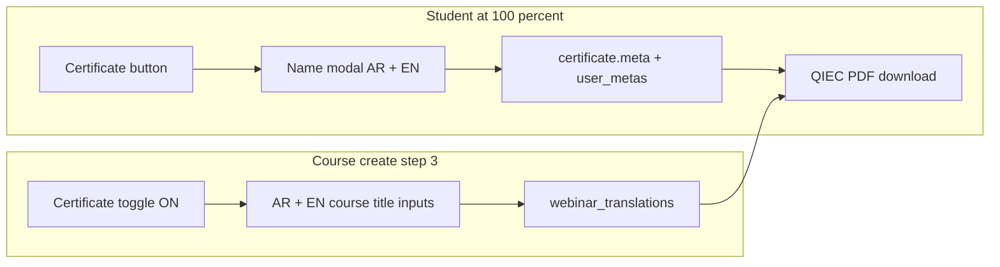

# Bilingual certificate data (student + course wizard)

## Problem

Auto-issued course certificates use one value twice:

- Trainee: [`MakeCertificate::buildQiecCertificateData`](app/Mixins/Certificate/MakeCertificate.php) sets `trainee_name_ar` and `trainee_name_en` from `users.full_name` when `certificates.meta` is empty.
- Course title: same method reads `webinar` translations; the wizard only collects a single `title` (usually `ar`), so the English slot is often empty or Arabic.

Admin manual create already supports AR/EN via `meta` ([`certificate-create.blade.php`](resources/views/panel_v1/admin/pages/education/certificate-create.blade.php)). Student auto-issue and the course wizard do not.

## Approach (chosen defaults)

- **Student names:** collect in a modal before first download; save on **`certificates.meta`** (`trainee_name_ar` / `trainee_name_en`) and remember in **`user_metas`** (`full_name_ar` / `full_name_en`) for future certificates. No `users` table migration.
- **Course titles:** when the certificate toggle is on in wizard step 3, show AR/EN course-name fields and persist into **`webinar_translations`** (`locale=ar` / `locale=en` `title`). `MakeCertificate` already prefers those translations—no change to the PDF template.

## 1. Course wizard — certificate course titles

**UI:** [`resources/views/panel_v1/instructor/pages/create-course/step-3.blade.php`](resources/views/panel_v1/instructor/pages/create-course/step-3.blade.php) (shared by instructor + admin via [`course-wizard.blade.php`](resources/views/panel_v1/admin/pages/education/course-wizard.blade.php)).

Under the existing toggle block, add a hidden-by-default panel (`data-certificate-titles`) with:

- `certificate_title_ar` — اسم الدورة (عربي), prefilled from draft Arabic title
- `certificate_title_en` — Course name (English)

Show/hide with a small JS toggle listener (wizard JS already under `resources/js/panel_v1/` or inline in create-course layout). Required only when `certificate=1` and not soft-autosave.

**Persist:** [`CourseWizardTrait::persistCourseWizardStep`](app/Http/Controllers/PanelV1/Support/CourseWizardTrait.php) step `3`:

- Validate both titles when `certificate` is true
- Write/update `WebinarTranslation` for `ar` and `en` `title` (Astrotomic pattern already used elsewhere for webinars)
- Keep `draft->certificate` boolean as today

**Prefill:** when loading step 3, pass `$draftCertificateTitleAr` / `$draftCertificateTitleEn` from existing translations (fallback: step-1 title for AR).

Optional consistency: same two fields next to the simple admin checkbox in [`course-form.blade.php`](resources/views/panel_v1/admin/pages/education/course-form.blade.php) if that form is still used for edits—only if that path remains live; primary surface is the wizard.

## 2. Student — name modal before certificate use

**When:** progress ≥ 100% and course has `certificate` enabled (button unlocked in course player navbar and download links on certificates page).

**Flow change:**

1. Keep auto-creating the `certificates` row at 100% (existing `Webinar::makeCertificateForUser`) so unlock/rewards stay intact.
2. Treat a certificate as **name-incomplete** if `meta.trainee_name_ar` and `meta.trainee_name_en` are both empty **and** user has no saved `user_metas` names.
3. Course player: unlocked “الشهادة” button opens a modal instead of `target="_blank"` download when incomplete ([`navbar.blade.php`](resources/views/panel_v1/student/course-player/components/navbar.blade.php)).
4. Certificates list: download/view links go through the same gate ([`certificates.blade.php`](resources/views/panel_v1/student/pages/certificates.blade.php)).
5. Modal fields: الاسم بالعربية / Name in English (prefill from `user_metas` or `full_name`).
6. New POST route e.g. `panel.v1.student.certificates.complete-names` → `StudentController`:
   - Authorize ownership
   - Validate both names
   - Upsert `user_metas` (`full_name_ar`, `full_name_en`)
   - Merge into `certificate.meta`
   - Return download URL (JSON for modal) or redirect to existing download route

**Download guard:** [`StudentController::downloadCertificate`](app/Http/Controllers/PanelV1/StudentController.php) — if still incomplete, redirect back to certificates page with a flash / query flag to open the modal (blocks raw URL bypass).

**Reuse:** [`buildQiecCertificateData`](app/Mixins/Certificate/MakeCertificate.php) already applies `meta` overrides. Optionally also fall back to `user_metas` when meta is empty so older incomplete rows pick up profile names after one save—small addition in `buildQiecCertificateData` after loading `$student`.

## 3. Files to touch (minimal)

| Area | Files |
|------|--------|
| Wizard UI | `step-3.blade.php` + small JS in panel_v1 create-course entry |
| Wizard save | `CourseWizardTrait.php` (step 3 validation + translations) |
| Student UI | course-player navbar + certificates page modal component |
| Student API | `routes/panel_v1.php`, `StudentController.php` |
| Render fallback | `MakeCertificate.php` (`user_metas` → trainee names) |
| Tests | Feature test: wizard saves EN title when cert on; student complete-names updates meta and download uses AR/EN |

## 4. Out of scope

- Changing QIEC PNG/PDF layout ([`qiec-template.blade.php`](resources/views/panel_v1/certificates/qiec-template.blade.php))
- Registration form bilingual names (collected at claim time instead)
- Quiz/bundle certificate types beyond the same meta/user_metas fallback (course flow is the primary path; download guard covers all student-owned certs)